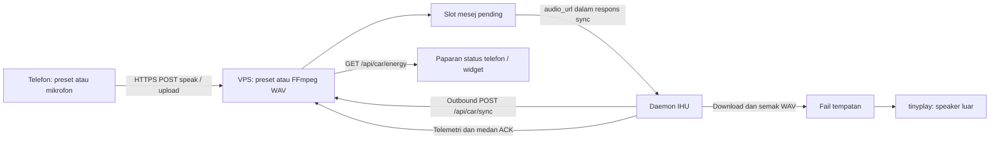

# Audit eMAS Remote: telefon, VPS dan IHU

**Kemaskini selepas audit:** eMAS Remote 2.0 sudah dibina dan pembetulan API/UI/APK dipasang pada VPS atas permintaan pengguna. Butang Proton dikekalkan; ACO OFF dan fail token tidak berubah. [Projek dan nota release](D:/apps/emas-ota/EmasRemoteApp/README.md). Penemuan di bawah merekodkan versi sebelum pembetulan; had ACK dan ujian speaker fizikal masih terpakai.

Tarikh pemeriksaan: 8 Oktober 2026. Sasaran sebenar ialah APK telefon `com.azam.emaswidget`, bukan aplikasi dashboard IHU atau companion yang bergantung pada komputer.

## Keputusan dan konteks token

Token ACO memang tersedia kepada pemilik, tetapi sengaja tidak diaktifkan pada VPS kerana penggunaan sebelum ini mengganggu sesi aplikasi Proton asal ketika hendak membuat tempahan servis. Ini ialah pilihan operasi pengguna, bukan bukti token hilang. Audit ini tidak memasang token, melakukan login atau mengaktifkan token refresh. Punca tepat sesi Proton tersingkir belum diuji; jangan cuba membuktikannya dengan mengaktifkan semula integrasi.

Aplikasi masih berguna sebagai alat megafon. Masalah utamanya ialah paparan masih menawarkan banyak fungsi tanpa menyesuaikan diri dengan integrasi ACO yang dimatikan, di samping beberapa bug sebenar pada data dan penghantaran suara. Menambah token bukan penyelesaian yang sesuai untuk keadaan ini.

Cadangan: jadikan telefon aplikasi **Megafon + status IHU yang benar-benar tersedia**. Kekalkan aplikasi Proton asal untuk servis dan fungsi rasmi. Pada IHU, utamakan status serta tetapan tempatan yang terbukti disokong. Bahagian yang tiada pelaksana atau pengesahan perlu disembunyikan daripada halaman utama.

## Sistem yang benar-benar diperiksa

| Komponen | Bukti semasa |
|---|---|
| APK telefon | `eMAS_Remote.apk`, package `com.azam.emaswidget`, versi 1.3 / code 4; MainActivity, widget dan voice service dinyahkompil untuk pemeriksaan |
| Alamat WebView | `https://emas.43-159-63-29.nip.io` |
| VPS | Direktori `/home/ubuntu/emas5`; aplikasi sebenar dalam Docker `emas5`, Uvicorn port 8000, dipetakan kepada localhost 8012 |
| HTTPS | Caddy; halaman utama HTTP 200 dan kandungannya sepadan dengan fail statik VPS |
| Audio | FFmpeg tersedia; format sasaran sebenar PCM signed 16-bit, 48 kHz, mono |
| IHU | Android 10 / IHU801P, alamat ADB diketahui `192.168.1.16:5555`; JAR daemon yang dipasang diperiksa, proses daemon dan tinyplay ditemui semasa pemeriksaan |

Status `emas-server` melalui systemd bukan ukuran servis sebenar dalam pemasangan ini. Gunakan status dan log Docker. Telefon mencapai VPS terus; komputer dan alamat ADB kereta bukan gateway wajib untuk aplikasi telefon ini.

APK sedia ada boleh dimuat turun melalui [laluan APK VPS](https://emas.43-159-63-29.nip.io/download/apk). Ini APK yang ada sekarang, **bukan APK baharu yang sudah dibaiki**.

Salinan audit disimpan di `D:/apps/emas-ota/artifacts/remote-vps-audit-20261008-7b48afe3/`. Fail sumber mentah mengandungi konfigurasi aplikasi; jangan edarkan keseluruhan direktori sebagai pakej umum.

## Aliran data sebenar



Perbezaan penting daripada kontrak asal: daemon yang dipasang mengambil kerja melalui **POST `/api/car/sync`**. GET `/api/megafon/status` memaparkan slot pending dan suis; ia bukan pengesahan suara telah keluar. Jangan menghantar POST sync kosong sebagai ujian biasa: backend semasa boleh menyerahkan dan membuang kerja pending kepada pemanggil ujian itu.

Versi daemon yang diperiksa mengehadkan sela idle kepada kira-kira 3 saat walaupun server boleh meminta 45 saat; apabila suis aktif sekitar 1.2 saat. Latensi juga merangkumi muat naik, conversion, download dan baris gilir pemain. Jika IHU tidur atau tiada internet, tiada respons polling.

## Penemuan yang disahkan

### 1. Paparan bergantung pada ACO walaupun ACO sengaja dimatikan

`vps_index_live.html:65` membaca `/api/status` dalam `refresh()`. Apabila bacaan ACO gagal, keseluruhan refresh gagal sebelum `refreshWindows()` dijalankan. Ia juga tidak membaca SOC daripada `/api/car/energy` untuk paparan utama. Jadi “Offline” pada dashboard tidak semestinya bermaksud VPS atau megafon gagal.

Pemeriksaan awal sebelum penjelasan pengguna mendapat HTTP luar 200 tetapi `status:500` dalam respons ACO. Ini perlu ditafsirkan sebagai integrasi tidak tersedia. Jangan mengatasinya dengan memasang semula token secara automatik.

**Pembetulan:** konfigurasi kemampuan yang eksplisit, contohnya `aco_enabled: false`. Semasa dimatikan, jangan panggil endpoint ACO atau refresh token. Ambil status megafon, heartbeat IHU dan telemetri tempatan secara berasingan. Kegagalan satu panel tidak boleh menggagalkan semua panel.

### 2. SOC contoh bercampur dengan data sebenar

`vps_server_live.py:871` mempunyai nilai awal `battery.soc_pct: 82`. Sync mengemas kini medan SOC di aras lain, sedangkan widget membaca `energy.battery.soc_pct` (`EmasWidgetProvider.java:109`). Semasa pemeriksaan, respons mempunyai SOC aras luar 38 dan SOC nested 82. Nilai contoh boleh kelihatan seperti data sebenar.

**Pembetulan:** satu kontrak SOC yang konsisten untuk server, WebView dan widget. Tiada nilai contoh dalam laluan produksi. Sertakan `source`, `updated_at` dan status freshness. Data tiada atau lama perlu dipaparkan sebagai “Tiada bacaan” / “Bacaan terakhir”, bukan nilai semasa. Jangan simpulkan suhu, TPMS, kunci atau tingkap daripada medan yang tiada.

### 3. Queue VPS sebenarnya hanya satu slot

`car_megaphone_pending` ialah satu objek global (`vps_server_live.py:513,567,608`). Mesej kedua menimpa mesej pertama jika belum diambil. Handler sync mengosongkannya semasa menyerahkan respons (`:947–949`), sebelum download atau playback disahkan. Medan ACK daripada daemon tidak digunakan untuk melengkapkan penghantaran.

Empat keadaan direproduksi dalam proses terpencil menggunakan handler salinan: permintaan tanpa auth ketika suis OFF diterima; mesej kedua menimpa mesej pertama; klien sync boleh mengambil mesej tanpa playback ACK; dan kegagalan conversion masih menghasilkan kejayaan palsu. Tiada perubahan kepada queue produksi dibuat oleh reproduksi ini.

**Pembetulan:** queue terhad yang disimpan, ID unik, expiry dan keadaan `queued → claimed → downloaded → played / failed`. Claim hanya kepada daemon yang dikenal pasti. Jangan hapus kerja sehingga ACK playback atau kegagalan diterima. Retry perlu terhad dan berasaskan ID; jangan mengulang POST telefon secara membuta tuli kerana ia boleh menggandakan suara. ACK pemain menunjukkan proses playback berjaya; ia belum membuktikan bunyi fizikal speaker tanpa pemerhatian di kereta.

### 4. Suis OFF tidak menghalang penghantaran atau playback

Handler `speak`, `upload` dan dispatch sync tidak menguatkuasakan suis. OFF mempengaruhi cadence polling tetapi bukan interlock playback. Permintaan boleh diterima dan dihantar walaupun OFF.

**Pembetulan:** semak suis dan expiry pada penerimaan serta dispatch; jangan hantar kerja yang sudah luput. Daemon juga perlu menolak kerja yang tidak lagi dibenarkan. Pilihan menghentikan suara yang sedang dimainkan memerlukan kontrak berasingan dan ujian kereta.

### 5. Endpoint megafon belum menguatkuasakan API key

Semakan kod menunjukkan tiada `check_key` pada handler megafon speak/upload/switch, walaupun beberapa endpoint lain dilindungi. GET status tanpa key memberi HTTP 200; laluan tulis tanpa auth direproduksi pada salinan handler sahaja. Tiada ujian POST tanpa auth dihantar ke produksi.

**Pembetulan:** lindungi laluan tulis dan sync serta kemas kini semua klien serentak. `WidgetVoiceService` kini memuat naik tanpa header key, jadi menambah auth server sahaja akan mematahkan widget. Key yang tertanam dalam frontend awam tidak boleh menjadi rahsia yang dipercayai; gunakan sesi pengguna atau credential per peranti untuk pengesahan sebenar. Ini kelemahan yang ditemui dalam aplikasi semasa.

### 6. FFmpeg gagal tetapi fail tetap dilabel WAV dan diqueue

`vps_server_live.py:577–615` membaca upload tanpa had dan memanggil `subprocess.run` secara segerak dalam handler async. Conversion boleh menghalang event loop. Fallback menyimpan audio asal sebagai `.wav` walaupun conversion gagal dan masih memulangkan `ok:true`.

Fail sedia ada `mega_1791259801915.wav`, 110 byte, ditolak oleh pemeriksaan format; ia bukan WAV PCM lengkap. Preset `alihkan.wav` yang dimuat turun lulus pemeriksaan PCM 48 kHz mono 16-bit. Preset `terima_kasih.wav` memberi 404, sedangkan speak boleh mengqueue URL itu tanpa semakan kewujudan.

**Pembetulan:** had upload dan tempoh, worker conversion dengan concurrency terhad, semak exit code dan ffprobe sebelum publish secara atomik. Gagal conversion mesti return ralat dan tidak mengqueue apa-apa. Validate preset terhadap fail sebenar; sembunyikan atau baiki preset yang tiada.

### 7. UI mendakwa berjaya selepas kegagalan dan menulis AVAS ketika dibuka

`preset()` menetapkan “Dihantar” tanpa menggunakan hasil `post()` (`vps_index_live.html:67`). Startup memanggil `selectAvas(3)` (`:71`), yang menghantar POST tanpa tap pengguna. Kedua-duanya direproduksi dalam JavaScript sandbox tanpa rangkaian.

**Pembetulan:** semasa page load, baca state sahaja. Perubahan AVAS hanya selepas tindakan pengguna. Papar “Menunggu IHU” selepas server menerima queue; “Dimainkan” hanya selepas ACK. Preset gagal mesti kekal gagal, dengan mesej sebab yang jelas.

### 8. Race mikrofon dan pengurusan request

Jika jari dilepaskan sebelum izin mikrofon selesai, recorder belum wujud ketika pointerup. Recorder kemudian bermula selepas jari dilepaskan. Keadaan ini direproduksi secara offline. Tiada had durasi yang jelas; cleanup apabila halaman ditutup/disembunyikan tidak lengkap. Upload melabel blob sebagai WebM tanpa mengikut MIME recorder sebenar.

Polling halaman menyemak `document.hidden` sebelum refresh tetapi timer masih wujud dan request yang telah berjalan tidak dibatalkan. Fetch tiada deadline atau pembatalan; beberapa bacaan boleh bertindih. Bukti ini menunjukkan kekurangan lifecycle dan timeout, **bukan pengesahan memory leak melalui profiling heap**.

**Pembetulan:** keadaan `idle/requesting/recording/uploading`, token percubaan rakaman untuk membatalkan permission yang lambat, `pointercancel`, pagehide cleanup, had rakaman, MIME melalui `MediaRecorder.isTypeSupported`. Gunakan satu request aktif per poller, AbortController, deadline dan backoff untuk bacaan. Serikan kawalan melalui queue terhad; POST tidak diulang automatik tanpa idempotency.

### 9. WebView dan widget perlu permission yang betul

MainActivity memberi semua `PermissionRequest.getResources()` secara terus (`:136`). Medan pending runtime permission wujud tetapi tidak ditetapkan untuk aliran deferral. Origin tidak diperiksa. Perkhidmatan widget memulakan microphone foreground service di luar blok perlindungan rakaman; permission dan lifecycle perlu disemak sebelum bermula.

Helper `WebViewMicrophoneGate.java` disediakan sebagai contoh integrasi: hanya HTTPS hos aplikasi, hanya audio capture, tunggu permission Android, deny permintaan yang dibatalkan atau tidak dipercayai. Helper telah dikompil terhadap Android API jar; ia belum digabungkan ke APK. Kod decompile bukan projek build asli yang lengkap.

Panduan Android sendiri melarang corak grant semua resources secara membuta tuli: [PermissionRequest](https://developer.android.com/reference/android/webkit/PermissionRequest). Permission microphone dan sekatan foreground service perlu dipatuhi: [microphone service type](https://developer.android.com/develop/background-work/services/fgs/service-types#microphone). Hadkan navigasi halaman yang mempunyai bridge kepada origin dipercayai: [WebView](https://developer.android.com/develop/ui/views/layout/webapps/webview).

### 10. Risiko khusus daemon yang dipasang

ACK/ID ditetapkan ketika menerima kerja, sebelum tinyplay berjaya. Hasil boolean download tidak diperiksa dalam laluan sync sebelum validasi fail cache; kegagalan download boleh menyebabkan audio lama digunakan bagi ID baharu. Ini penemuan analisis JAR, belum direproduksi dengan speaker fizikal.

Pemain tempatan sudah menggunakan salinan WAV unik untuk kerja beratur; jangan menuduh semua fail queue ditimpa. JAR dipasang juga berbeza daripada sumber workspace terkini. Laluan playback menghentikan `avas_service`, menjalankan tinyplay dan cuba memulihkan servis selepasnya; perubahan di sini memerlukan ujian di kereta. Audit ini tidak menjalankan tinyplay, menukar servis atau memasang daemon.

## Fungsi yang patut kekal atau disembunyikan

| Fungsi | Keputusan disyorkan | Syarat |
|---|---|---|
| Megafon PTT dan preset | Kekalkan sebagai halaman utama | Baiki queue, auth, conversion, suis dan status playback |
| Widget mikrofon | Kekalkan sebagai shortcut | Permission betul; bezakan queued dan played |
| SOC/range daripada daemon | Kekalkan selepas baiki schema | Sumber sebenar, timestamp dan stale state wajib |
| Fungsi bergantung pada ACO | Sembunyikan semasa ACO OFF | Tiada login atau refresh token automatik |
| Tempahan servis dan fungsi rasmi | Gunakan aplikasi Proton asal | Elakkan companion merebut sesi pengguna |
| Tingkap, but, frunk dan launch app | Sorok daripada halaman utama sehingga disahkan | HTTP 200 atau pending bukan bukti actuator berfungsi |
| Profil AVAS / lock sound | Letak dalam tetapan hanya jika sokongan disahkan | Read-back state sebenar; jangan tulis ketika membuka halaman |
| Panel HVAC/camp/power lama di IHU | Sorok jika kawalan tidak tersedia | Polisi bridge semasa menyekat sebahagian request legacy walaupun panel masih ada |

Audit membaca endpoint tingkap, but, frunk dan launch status; ia tidak mengaktifkan actuator. Oleh itu belum ada bukti untuk menyatakan semua kawalan tersebut rosak. Panel yang tiada sokongan jelas memang menambah kekeliruan, tetapi megafon dan telemetri IHU mempunyai peranan yang berbeza daripada aplikasi rasmi.

## Susunan UI yang dicadangkan

1. Bar atas: “VPS tersedia” dan “IHU aktif / tiada heartbeat”; jangan samakan kedua-duanya.
2. Kad utama megafon: suis beserta countdown, empat preset yang tersedia, butang PTT besar dan status mesej terakhir.
3. Kad status kecil: SOC/range sebenar dengan masa bacaan. Jika stale, tunjuk “Bacaan terakhir”; jika tiada, `—`.
4. Tetapan: hanya kemampuan yang tersedia, diagnostik ringkas dan pautan bantuan. Tiada input IP ADB sebagai syarat telefon menggunakan VPS.

Pisahkan kod kepada `api-client.js`, `capabilities.js`, `telemetry-view.js`, `megaphone-controller.js` dan CSS layout. Sentuhan sekurang-kurangnya 48 px, satu kolum pada telefon kecil, feedback pressed/disabled yang jelas, safe-area padding dan haptic apabila disokong. Status “Dimainkan” perlu datang daripada server/daemon; toast HTTP sahaja tidak cukup.

## Skrip ujian yang disediakan

Lokasi:

- `D:/apps/emas-ota/artifacts/remote-vps-audit-20261008-7b48afe3/test-emas-remote.ps1`
- `D:/apps/emas-ota/artifacts/remote-vps-audit-20261008-7b48afe3/test-emas-remote.sh`
- `D:/apps/emas-ota/artifacts/remote-vps-audit-20261008-7b48afe3/WebViewMicrophoneGate.java`

Key diminta secara tersembunyi jika environment `EMAS_API_KEY` tiada. Key tidak ditulis dalam skrip. Mode Auth menggunakan **GET `/api/push/public-key`**, endpoint VPS sahaja, supaya tidak menghubungi ACO. Timeout ditetapkan; tiada retry automatik bagi POST.

Contoh Windows, dari direktori skrip:

```powershell
.\test-emas-remote.ps1 -Action Auth
.\test-emas-remote.ps1 -Action Status
.\test-emas-remote.ps1 -Action Wav -AudioUrl 'https://emas.43-159-63-29.nip.io/static/megafon/alihkan.wav'
.\test-emas-remote.ps1 -Action Daemon
```

Contoh Bash:

```bash
bash test-emas-remote.sh auth
bash test-emas-remote.sh status
bash test-emas-remote.sh wav 'https://emas.43-159-63-29.nip.io/static/megafon/alihkan.wav'
bash test-emas-remote.sh daemon
```

Auth yang dijangka: tiada key 401, key salah 401, key betul 200. Kedua-dua skrip telah lulus ujian ini pada VPS, tanpa ACO. WAV checker telah menerima preset PCM yang sah dan menolak contoh fail rosak. Mode Daemon memerlukan SSH yang sudah dibenarkan dan sambungan ADB kereta yang tersedia; ia hanya membaca proses/log.

Mode berikut **menghantar arahan sebenar** dan disediakan untuk ujian terkawal apabila kereta serta pemerhati tersedia; mode ini tidak dijalankan dalam audit:

```powershell
.\test-emas-remote.ps1 -Action SwitchOn
.\test-emas-remote.ps1 -Action Preset -Preset alihkan
.\test-emas-remote.ps1 -Action Upload -AudioFile 'C:\laluan\rakaman.webm'
.\test-emas-remote.ps1 -Action SwitchOff
```

```bash
bash test-emas-remote.sh switch-on
bash test-emas-remote.sh preset alihkan
bash test-emas-remote.sh upload /laluan/rakaman.webm
bash test-emas-remote.sh switch-off
```

Mode Preset menyemak suis dan fail WAV sebelum queue. Preset `terima_kasih` akan berhenti apabila fail memberi 404, bukannya mengqueue mesej yang tidak boleh dimainkan. Upload memeriksa format fail hasil conversion selepas respons. Backend semasa masih boleh mengqueue hasil rosak sebelum semakan klien, jadi pembetulan server diperlukan.

## Integrasi helper microphone

Gabungkan helper ke projek asli `com.azam.emaswidget`. Jangan menggantikan keseluruhan Activity dengan kelas helper ini. Jika Activity mempunyai callback progress sedia ada, gabungkan callback itu dalam WebChromeClient yang sama.

```java
// Selepas webView diwujudkan:
microphoneGate = new WebViewMicrophoneGate(this, webView);
webView.setWebChromeClient(microphoneGate);

// Dalam callback onRequestPermissionsResult sedia ada:
microphoneGate.onRuntimePermissionResult(requestCode, grantResults);

// Dalam onPause:
microphoneGate.cancelPending();
webView.onPause();

// Dalam onResume:
webView.onResume();

// Dalam onDestroy:
microphoneGate.release();
webView.destroy();
```

Tambah deklarasi field Activity untuk helper, kekalkan permission manifest RECORD_AUDIO, dan hadkan WebViewClient kepada origin dipercayai sebelum halaman asing mendapat akses bridge. Frontend masih perlu cleanup MediaStream apabila pagehide; helper permission sahaja tidak membaiki race PTT atau menghentikan rakaman yang sudah aktif. Ujian helper di telefon belum dijalankan.

## Langkah pengesahan di telefon selepas pembetulan

1. Buka APK; tiada arahan AVAS atau kawalan kereta dihantar hanya kerana halaman dibuka. ACO kekal OFF dan tiada request status/login/refresh ACO.
2. Buka aplikasi Proton asal dan laluan servis. Pastikan companion tidak mencetus login atau mengganti sesi; jangan aktifkan token untuk ujian ini.
3. Benarkan/nafi microphone, kemudian tekan dan lepaskan PTT sebelum dialog permission selesai. Selepas jari dilepaskan, tiada rakaman baharu patut bermula sendiri.
4. Minimize ketika permission menunggu atau rakaman berjalan. Track microphone dibersihkan; kembali ke aplikasi tidak mencipta poller kedua.
5. Tukar Wi-Fi/data dan uji IHU tidur. Paparan membezakan VPS boleh dicapai dengan IHU tidak aktif; bacaan lama dilabel dengan waktunya.
6. Hantar dua mesej pendek mengikut urutan; kedua-duanya mempunyai ID dan status berasingan. Pemerhati di kereta mengesahkan urutan bunyi. ACK hanya ditetapkan selepas hasil pemain.
7. Uji conversion rosak, preset tiada, respons kosong/HTML 404/500 dan timeout dalam persekitaran ujian. Tiada status “Dihantar” palsu atau queue audio rosak.
8. Uji telefon kecil, orientasi berbeza dan teks besar; butang tidak bertindih dan countdown/ralat mudah dibaca.

## Batas hasil dan kesilapan skop terdahulu

Hasil ini ialah audit, reproduksi bug, skrip ujian dan helper permission. UI, backend dan APK produksi belum dibetulkan atau dideploy oleh pakej audit ini. Tiada playback speaker atau actuator fizikal dijalankan. Online/offline ialah snapshot, bukan jaminan keadaan kereta selepas audit.

Pemasangan sebelum pembetulan sasaran tersasar kepada APK IHU `com.noor.thenoorcar`. Backup sebelum pemasangan berada di `D:/apps/emas-ota/artifacts/companion-install-20261008-e4fe64aa/NoorEnergy-before.apk`; tiada restore/uninstall tambahan dilakukan oleh audit ini. Wrapper telefon `com.emas.companion` yang dibuat sebelum sasaran dijelaskan bukan pengganti eMAS Remote dan tidak patut digunakan untuk aliran VPS ini.
