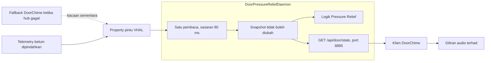

# DoorStateHub — Peringkat 2B, calon laptop

Tarikh: 8 Oktober 2026, Asia/Kuala_Lumpur.

Endpoint dan klien DoorChime telah dibina dan diuji di laptop. Tiada sambungan, pemasangan, arahan cermin, restart daemon atau ujian audio dilakukan pada kereta dalam kerja 2B ini. Telemetry belum dipindahkan.

## Keputusan seni bina

DoorPressureReliefDaemon menjadi host satu sampler pintu, dengan sela sasaran 80 ms. Sampler berasingan daripada logik cermin supaya penulisan cermin yang lambat tidak menghentikan penerbitan snapshot. Loop Pressure Relief menunggu snapshot baharu dan tidak membaca property pintu sendiri. Ia menyemak kesegaran semula selepas membaca kedudukan cermin dan sebelum memproses arahan automatik.

DoorChime menggunakan HTTP loopback untuk memperoleh satu snapshot empat pintu. Memori Java dikongsi hanya dalam proses host; HTTP menghubungkan dua JVM berasingan. Tiada daemon ART keenam ditambah.



## Kontrak endpoint

`GET http://127.0.0.1:8885/api/door/state` sahaja. Laluan yang hampir sama dan kaedah POST tidak boleh mencetuskan kawalan cermin. Respons menggunakan `Cache-Control: no-store`.

Contoh ilustrasi, bukan bacaan daripada kereta:

```json
{
  "schema": 1,
  "ok": true,
  "generation": "0123456789abcdef0123456789abcdef",
  "sequence": 42,
  "timestamp": 1791442800000,
  "sampled_elapsed_ms": 10000,
  "age_ms": 20,
  "fl": "CLOSED", "fl_epoch": 1,
  "fr": "CLOSED", "fr_epoch": 1,
  "rl": "CLOSED", "rl_epoch": 1,
  "rr": "CLOSED", "rr_epoch": 1,
  "opened": false,
  "complete": true
}
```

- `OPEN`, `CLOSED`, `UNKNOWN` kekal tiga keadaan berasingan. Property mesti berstatus AVAILABLE, dengan integer 0/1 atau satu bait 0/1. Bacaan gagal, status lain atau payload tidak sah menjadi UNKNOWN.
- `ok=true` bermaksud sampler mempunyai snapshot segar, bukan semua sensor diketahui. Sensor UNKNOWN yang dibaca daripada hub hidup tetap berautoriti dan tidak mencetuskan fallback.
- `complete=true` hanya apabila keempat-empat sensor diketahui. `opened=true` apabila mana-mana pintu diketahui terbuka; false apabila semua tertutup; null apabila tiada pintu diketahui terbuka tetapi ada UNKNOWN.
- `generation` berubah apabila host dicipta semula. `sequence` meningkat bagi setiap sweep. `timestamp` ialah masa dinding untuk paparan sahaja.
- Kesegaran menggunakan `sampled_elapsed_ms`, pada asas masa Android elapsedRealtime yang sama dalam boot tersebut. Had calon ialah 400 ms. Masa dicatat pada permulaan sweep, supaya panggilan lambat tidak menjadikan bacaan awal kelihatan baharu. Asas masa ini merangkumi tidur peranti. [Rujukan Android SystemClock](https://developer.android.com/reference/android/os/SystemClock)
- Tiada sampel atau sampel melebihi had umur: HTTP 503, ok=false, keadaan dieksport sebagai UNKNOWN. Respons ini tidak membaca VHAL semula.
- Setiap `*_epoch` meningkat apabila kesinambungan sensor terputus melalui UNKNOWN atau sela sampling panjang. Ini membolehkan pengguna snapshot mengesan gangguan walaupun mereka terlepas keseluruhan kitaran UNKNOWN/pulih.

Adapter memeriksa status AVAILABLE secara eksplisit. Kontrak ketersediaan ini wujud dalam Android 10; sokongan callback khusus property vendor masih belum diuji. [Sumber AOSP Android 10](https://android.googlesource.com/platform/packages/services/Car/+/refs/tags/android-10.0.0_r40/car-lib/src/android/car/hardware/property/CarPropertyManager.java)

## Tingkah laku klien dan had sumber

DoorChime mengambil snapshot dan menunggu 80 ms selepas setiap kitaran. Masa HTTP ditambah kepada sela itu; kadar sebenar boleh kurang daripada 12.5 permintaan/saat. Timeout sambungan 80 ms, deadline bacaan keseluruhan 200 ms, had header/body 4096 bait; tiada redirect atau chunked response.

Fallback VHAL hanya dibenarkan selepas kegagalan hub berterusan sekurang-kurangnya satu saat. Semasa fallback, probe HTTP dihadkan kepada sekali setiap satu saat. Bacaan fallback menggunakan satu worker dan satu operasi tertunda sahaja. Menunggu keputusan di thread chime dihadkan kepada 60 ms. Jika Binder tersangkut, thread chime terus boleh memeriksa pemulihan hub; tiada worker gantian ditambah berulang kali. Ini tidak membatalkan atau menjamin tamatnya panggilan Binder yang sudah tersangkut.

Pemulihan hub menghentikan penghantaran tugas fallback baharu. Satu tugas yang sudah bermula boleh masih menyelesaikan bacaan selepas pemulihan. Jadi pembaca tunggal ialah keadaan operasi normal, bukan jaminan mutlak semasa failover.

Startup, perubahan generation/sumber, UNKNOWN, gangguan epoch dan pemulihan masing-masing membentuk baseline senyap. Snapshot ini bukan log peristiwa: buka/tutup yang sepenuhnya berlaku di antara dua sampel boleh terlepas; peristiwa lama tidak dimainkan semula. Chime membuka dan menutup mengekalkan cooldown berasingan dua saat. Audio menggunakan satu worker, giliran dua tugas dan pelepasan AudioTrack melalui finally.

Server menggunakan dua worker pembaca dengan giliran lapan, dan satu worker arahan cermin dengan giliran empat. Parser mempunyai deadline 300 ms dari penerimaan socket. Giliran penuh menghasilkan 503; arahan cermin yang menunggu sehingga deadline tamat ditolak tanpa memanggil pengendali cermin. Ini bukan timeout untuk penulisan Binder yang sudah bermula.

## Angka sumber yang betul

Angka berikut hanya untuk empat sensor pintu kabin, berdasarkan sela nominal asal. Ia tidak memasukkan trunk/frunk, bacaan cermin, overhead HTTP atau masa kerja sebenar.

| Tahap | Anggaran panggilan property pintu/saat | Pengurangan daripada asal |
|---|---:|---:|
| Asal: Chime 80 ms + Pressure 120 ms + Telemetry 500 ms | 91.3 | — |
| Calon ini: host 80 ms + Telemetry masih 500 ms | 58.0 | 36.5% |
| Selepas Telemetry turut menggunakan snapshot | 50.0 | 45.2% |

12.5 ialah jumlah sweep empat pintu/saat, bukan jumlah panggilan property. Tiada API bacaan empat property secara batch digunakan. CPU, RAM, context-switch, masa Binder dan suhu pada IHU belum diukur selepas perubahan. HTTP memperkenalkan kerja socket/JSON sendiri; pengurangan panggilan property tidak membuktikan pengurangan CPU dengan peratus yang sama. Lima JVM masih lima JVM sehingga penyatuan daemon kemudian.

## Bukti binaan dan ujian

Binaan terakhir yang diperiksa:

`D:\apps\emas-ota\artifacts\door-hub-candidate-20261008-152307-401\`

- `door_pressure_relief.jar`: 23,127 bait; D8 minimum API 29.
- `door_chime.jar`: 15,277 bait; D8 minimum API 29.
- Hash dalam `SHA256.json`, output ujian dalam `test-results.log`.

140 semakan lulus: 84 hub/codec/klien/chime/HTTP, 7 mod pemerhatian pada daemon sebenar, 16 integrasi loop Pressure Relief dan sampler sebenar dengan I/O kenderaan diganti fixture, 17 regresi logik 2A sedia ada dan 16 regresi polisi HTTP sedia ada.

Ujian meliputi HTTP loopback sebenar, klien serentak tanpa bacaan VHAL tambahan, snapshot lama/tidak sah, UNKNOWN separa, restart generation, fallback terhad, fallback tersangkut, pemulihan sumber, gangguan sensor yang tidak diperhatikan klien, sampler tersangkut, arahan cermin fixture tersangkut, arahan beratur yang tamat masa, parser timeout dan perlindungan mod pemerhatian. Tiada ujian menggunakan motor cermin atau audio kereta.

JAR baseline di akar repo kekal tidak berubah. Source sebelum perubahan 2B disimpan di:

`D:\apps\emas-ota\artifacts\door-hub-before-20261008-150123-992\`

Untuk bina semula, gunakan `build_door_hub_candidate.ps1`; ia menjalankan semakan dan menghasilkan folder artifact baharu tanpa menggantikan baseline JAR. Skrip binaan lama diselaraskan untuk mencari sumber bersama, tetapi tidak digunakan untuk pembungkusan calon ini.

## Had 2A yang masih memerlukan pembetulan sebelum kawalan automatik

Perubahan 2A yang sudah ada dikekalkan. Kejayaan ujian 2A sedia ada tidak membuktikan keselamatan semua laluan cermin. Semakan source menunjukkan:

1. `tryOpenRelief` merekod sesi sebelum hasil penulisan dan pengesahan readback. Laluan normal masih tidak membatalkan sesi berdasarkan hasil write yang gagal.
2. `canAutoCloseRelief` menerima julat dari 0 hingga sasaran + 4; gerakan manual dalam julat itu dan gerakan keluar kemudian kembali tidak boleh dibezakan dengan kukuh.
3. Pemilikan ventilasi berdasarkan hasil write, tanpa pengesahan kedudukan berterusan. `stopVentilation(null)` masih mempunyai laluan asal menutup semua cermin.
4. Bacaan kedudukan cermin belum menyemak status property seperti adapter pintu yang baharu. Pemasa ventilasi masih menggunakan wall clock.
5. Laluan kawalan cermin GET sedia ada dikekalkan; hardening kaedah kawalan belum menjadi sebahagian kerja 2B ini.

Oleh itu calon ini sesuai untuk pilot sensor/chime dalam mod pemerhatian dahulu. Ia belum mendapat pengesahan untuk penggunaan kawalan cermin automatik semasa pemanduan. Tiada tuntutan zero-crash atau keselamatan 100%.

## Urutan pilot berikutnya

Pilot belum dilakukan. Jalankan ketika parkir dalam P selepas pengesahan keadaan dan izin pemasangan semasa daripada pemilik.

1. Ambil backup baharu JAR, pelancar, konfigurasi dan identiti proses yang benar-benar aktif pada kereta. Jangan bergantung pada baseline laptop sebagai bukti versi kereta semasa.
2. Tukar hanya host Pressure Relief dahulu dan lancarkan kelas `com.emas.window.DoorPressureReliefDaemon` dengan argumen `--observe-only`. Default tanpa argumen masih mod kawalan asal; jangan gunakan pelancar biasa tanpa argumen ini untuk pilot pemerhatian.
3. Sahkan `/api/status` menunjukkan observe_only=true, `/api/door/state` segar dan setiap pintu sepadan dengan keadaan fizikal. Mod pemerhatian menyekat write di lapisan `writeWindow`, laluan HTTP dan ventilasi; tiada bacaan kedudukan cermin bagi peralihan pemerhatian.
4. Tukar DoorChime dan semak baseline senyap, bunyi buka/tutup, UNKNOWN dan pemulihan host. Pilihan `--hub-only` sebagai argumen ketiga selepas dua laluan WAV mematikan fallback untuk ujian pembaca tunggal yang ketat.
5. Ukur PSS/CPU, kadar property dan latency sebenar sebelum/selepas. Semasa host baharu sudah aktif tetapi Chime lama masih berjalan, panggilan sementara boleh meningkat kepada sekitar 108/s; ini bukan keadaan akhir.
6. Kekalkan Telemetry seperti asal dalam pilot ini. Aktifkan semula kawalan automatik hanya selepas baki pembetulan/pengesahan ownership 2A diselesaikan dan diuji ketika parkir. Pulihkan pasangan JAR/pelancar asal daripada backup kereta apabila pilot ditamatkan jika calon belum diterima.

Tiada pelancar boot, AVAS, lock sound, Megaphone, Steering Mode atau Telemetry diubah atau dipasang dalam kerja ini.
