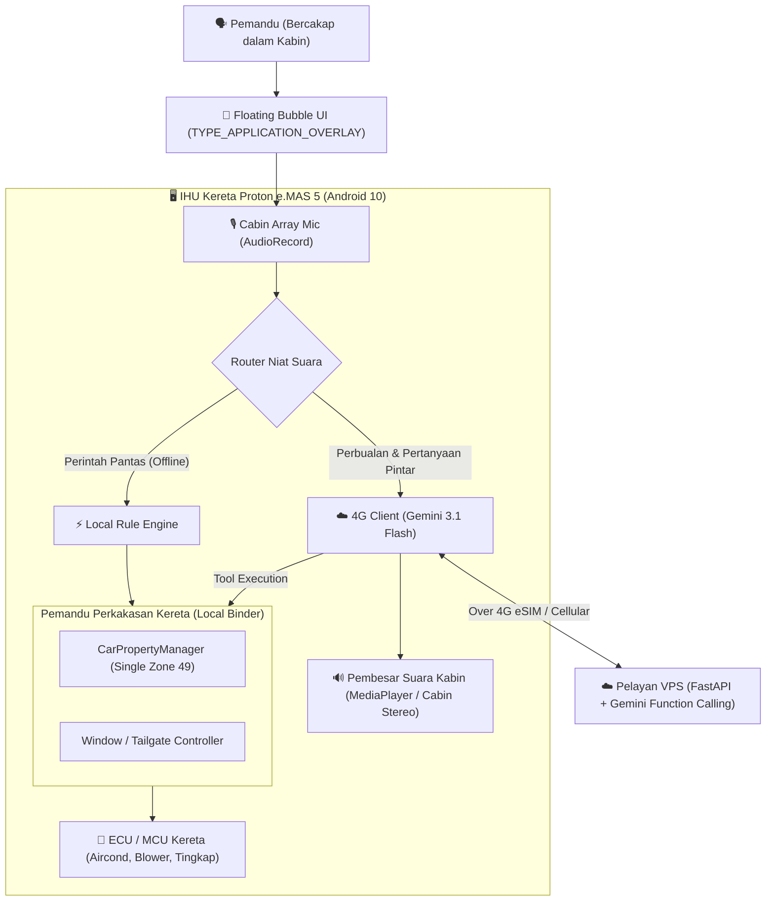

# 📋 PELAN PEMBANGUNAN: e.MAS Jarvis Cabin Floating Assistant (IHU801P)

Dokumen ini merangka pelan seni bina dan langkah pelaksanaan pembantu pintar kabin terapung (*Floating Bubble Voice Assistant*) yang berjalan terus di atas skrin IHU Proton e.MAS 5 (Android 10 API 29), menggunakan rangkaian selular 4G kenderaan dan sambungan VHAL perkakasan tempatan (Local IPC).

---

## 1. 🎯 Objektif & Ciri Utama

1. **Floating Bubble "Always on Top" (Pengganti Hi Proton):**
   * Ikon bulat pintar terapung di sisi skrin IHU di atas semua aplikasi (Waze, Spotify, Radio, Kamera 360).
   * Boleh diseret (*draggable*) ke mana-mana sudut skrin.
2. **Audio Kabin Sepenuhnya (Bukan Bumper Luar):**
   * Suara Gemini/Osman dimainkan melalui sistem audio stereo kabin kereta (`AudioManager.STREAM_MUSIC` / DSP kereta), menghasilkan bunyi yang jelas dan mantap.
3. **Kawalan Fizikal Kereta (Gemini Function Calling / Tool Calling):**
   * **Aircond / Klima:** Melaraskan suhu (16°C – 30°C), kelajuan blower (1–8), dan mod AC hidup/mati secara lisan.
   * **Tingkap & Bonet:** Buka tingkap celah ventilasi (7%), buka/tutup tingkap, kawal bonet.
   * **Navigasi & Peta:** Terus buka Waze / Google Maps bila ditanya lokasi atau tempat makan.
4. **Beroperasi Tanpa WiFi Rumah (Bebas Internet Rumah):**
   * Perintah fizikal kenderaan (Aircond & Tingkap) berjalan secara **100% Tempatan (Local VHAL IPC)** tanpa perlukan sambungan internet.
   * Pertanyaan AI & perbualan umum memanfaatkan sambungan data selular 4G eSIM kereta sedia ada atau pelayan VPS persendirian.

---

## 2. 🏛️ Seni Bina Sistem (Architecture)

---

## 3. 🧩 Modul-Modul Utama

### Modul A: Floating Bubble Service (`FloatingBubbleService.java`)
* Menggunakan `WindowManager` dengan bendera `WindowManager.LayoutParams.TYPE_APPLICATION_OVERLAY`.
* Mengendalikan `OnTouchListener` untuk sentuhan satu jari (ketik untuk bercakap, atau heret untuk ubah kedudukan bucu skrin).
* Animasi *pulsing glow ring* apabila sedang mendengar suara pemandu.

### Modul B: Pengurusan Audio Kabin (`CabinAudioEngine.java`)
* Menggunakan mikrofon kabin IHU melalui `AudioRecord` (16kHz Mono PCM).
* Output jawapan suara dimainkan melalui `MediaPlayer` menggunakan aliran audio `AudioAttributes.USAGE_ASSISTANCE_NAVIGATION_GUIDANCE` atau `USAGE_MEDIA` supaya audio muzik sedia ada diredamkan secara automatik (*audio ducking*) semasa AI bercakap.

### Modul C: Jambatan VHAL Tempatan (`VehicleBridge.java`)
Menggunakan penemuan penyelidikan yang telah disahkan sebelum ini:
* **HVAC Temperature:** `HVAC_TEMPERATURE_SET` (`0x21400503`), Kawasan 49 (Single Zone), Float `16.0` - `30.0`.
* **HVAC Fan Speed:** `HVAC_FAN_SPEED` (`0x21400500`), Kawasan 49, Int `1` - `8`.
* **HVAC AC State:** `HVAC_AC_ON` (`0x21200505`), Kawasan 49, Int `1` / `0`.
* **Window Venting:** Kawalan VHAL / daemon `door_pressure_relief` untuk menurunkan tingkap 7% atau menutup rapat.

### Modul D: Gemini AI Intent & Function Calling
Gemini dipasang dengan *Declaration Tools*:
1. `set_climate(temp_c: float, fan_speed: int, ac_on: bool)`
2. `set_windows(action: "vent" | "open" | "close")`
3. `open_navigation(destination: string, category: string)`
4. `chat_response(text: string)`

---

## 4. 📅 Fasa Pelaksanaan

| Fasa | Skop Kerja | Output |
| :--- | :--- | :--- |
| **Fasa 1** | Pembangunan Teras UI Floating Bubble & Pengesahan Overlay di IHU | APK Ujian dengan ikon terapung boleh heret dan kebenaran `SYSTEM_ALERT_WINDOW` |
| **Fasa 2** | Integrasi Pemandu VHAL Tempatan (Aircond & Tingkap) | Butang pintas pada overlay mengawal suhu dan blower tanpa internet |
| **Fasa 3** | Enjin Suara Kabin & Gemini Function Calling (4G) | Suara dihantar ke Gemini ➔ memanggil fungsi aircond/peta ➔ suara Osman keluar di speaker kabin |
| **Fasa 4** | Integrasi Navigasi Pantas (Google Maps / Waze) | Arahan lisan cari kedai makan terus melancarkan peta di skrin IHU |
| **Fasa 5** | Pemasangan & Persistensi pada IHU Kereta | Pemasangan sebagai System / Auto-start App di IHU |

---

## 5. 🛠️ Kaedah Pemasangan ke Kereta Tanpa WiFi Rumah

Oleh kerana kereta berada di luar dan menggunakan sambungan selular 4G (bukan WiFi rumah):
1. **Muat Turun Terus Pada Browser IHU:**
   * Kita letakkan fail binaan APK siap di pelayan VPS:  
     `https://emas.43-159-63-29.nip.io/static/apk/EmasJarvisCabin.apk`
   * Buka browser di skrin IHU kereta (melalui data 4G eSIM kereta), muat turun dan tekan pasang!
2. **Kebenaran Root Automatik:**
   * Daemon `DoorPressureReliefDaemon` yang sedia ada di kereta mempunyai akses root dan boleh memberikan kebenaran `SYSTEM_ALERT_WINDOW` secara automatik tanpa pemandu perlu masuk ke menu Settings yang tersembunyi.
